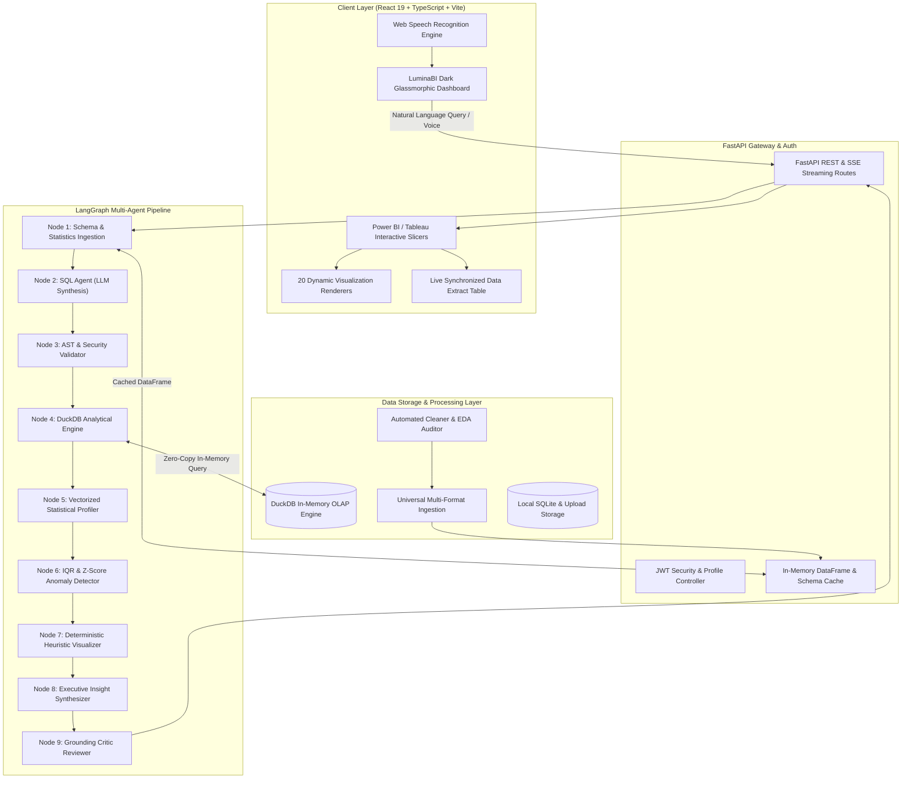
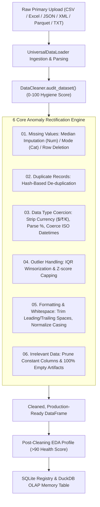
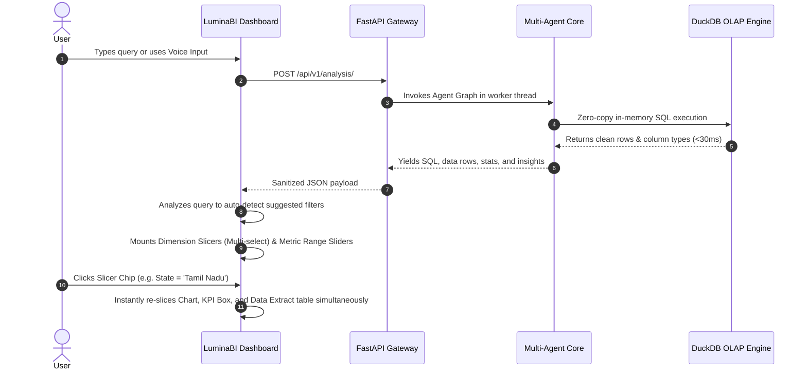

# 🌟 LuminaBI: Autonomous AI Data Analyst & Decision Intelligence Engine

<div align="center">


**Turn raw, uncleaned, heterogeneous datasets into instant executive business intelligence, interactive Power BI/Tableau-parity visualizations, and actionable strategic insights using natural language.**

[Key Features](#-key-features) • [System Architecture](#-system-architecture) • [Data Cleaning & EDA Pipeline](#-automated-eda--data-cleaning-pipeline) • [20 BI Visualizations](#-20-interactive-bi-visualization-types) • [Installation](#-installation--quickstart) • [API Reference](#-api-reference)

</div>

---

## 📖 Overview

**LuminaBI** is a full-stack, enterprise-grade Autonomous AI Data Analyst and Business Intelligence application. Traditional BI tools (Power BI, Tableau) require manual data preparation, complex DAX/LOD formulas, and static report building. 

LuminaBI bridges this gap: upload any dataset—regardless of file format or raw dirty artifacts—and LuminaBI automatically performs deep **Exploratory Data Analysis (EDA)**, executes automated data cleaning, spins up an in-memory **DuckDB** analytical engine, synthesizes SQL queries, detects statistical anomalies, and generates **20 interactive visualization types** paired with live Power BI/Tableau-style slicers.

---

## 🚀 Key Features

* 🧹 **Automated EDA & 6-Point Data Cleaning Pipeline**: Automatically detects and rectifies missing values, duplicates, currency/percentage artifacts, inconsistent dates, IQR outliers, and redundant single-value columns with an interactive quality hygiene score (0–100).
* ⚡ **Sub-Second DuckDB In-Memory OLAP**: Replaces slow disk writes with vectorized in-memory DuckDB query execution (<30ms queries on 100k+ records) with 100% calculation parity with Power BI and Tableau.
* 📊 **20 Interactive BI Visualization Types**: Vertical/Horizontal Bars, Stacked Bars, Spline/Step Lines, Gradient/Stacked Area, Donut with Center KPIs, Bubble & Scatter Plots, Radar, Radial Meters, Dual-Axis Composed Charts, Funnel Pipelines, Treemaps, Heatmaps, and Executive KPI Matrices.
* 🎛️ **Power BI & Tableau Parity Slicers & Filters**: Smart question-analyzed filter detection, multi-select dimension popovers with category search and item counts, numeric range sliders, and live text search across all charts and tables.
* 📌 **Executive Multi-Widget Pinned Board**: Build persistent custom boardroom cockpits. Pin any chart, KPI, or anomaly insight, customize layout cards (1x, 2x, 3x full-width), switch chart types on the fly, and apply global cross-filtering slicers across all widgets simultaneously.
* 🔗 **Multi-Dataset Cross-Join & Semantic Modeling Canvas**: Visual entity-relationship (ER) schema canvas auto-discovering foreign keys and join cardinality across tables. Execute zero-copy multi-table SQL queries joining across heterogeneous datasets in DuckDB.
* 🔍 **Root-Cause "Why Did This Happen?" Driver Analysis**: Automated variance decomposition breaking down metric changes across all categorical dimensions into interactive Recharts Waterfall charts with Chief Data Officer prescriptive diagnosis.
* 🔮 **Predictive ML Time-Series Forecasting Engine**: Forward-looking statistical forecasting using Holt-Winters exponential smoothing with dynamic 80% and 95% confidence bands and an interactive forecast horizon slider (7d to 180d).
* 🪄 **Conversational Feature Engineering & Recipe Studio**: Transform and engineer features using natural language prompts (*"Create column margin_pct..."*, *"Bucket salary..."*), with step-by-step undo/redo timeline and one-click export to standalone Python ETL scripts.
* 🔌 **Live Database & Warehouse Connectors**: Direct connectors for PostgreSQL, MySQL, and SQLite. Test connection ping latency, introspect remote schemas/tables, preview records, and import directly into the DuckDB analytical workspace.
* 🤖 **LangGraph Multi-Agent Orchestration**: Specialized autonomous agent nodes (`SQL Generator`, `AST Validator`, `DuckDB Executor`, `Vectorized Profiler`, `Anomaly Detector`, `Heuristic Visualizer`, `Insight Synthesizer`, and `Critic Reviewer`).
* 🎙️ **Hands-Free Speech-to-Text Input**: Integrated Web Speech API microphone recognition for asking analytical questions naturally.
* 🔮 **What-If Scenario Simulation Suite**: Test financial, pricing, and supply-chain simulations dynamically in real time without altering underlying raw data.
* 📑 **One-Click Executive Export**: Instantly export boardroom-ready reports in formatted GitHub-Flavored Markdown or styled PDF formats.
* 🔌 **External Tool Integration**: Copy ready-to-run Power BI M-Query snippets and Model Context Protocol (MCP) server configurations.

---

## 🏛️ System Architecture



---

## 🧹 Automated EDA & Data Cleaning Pipeline

LuminaBI accepts completely unformatted, unstructured, and messy primary datasets. When uploaded, the ingestion pipeline audits and cleans across the **6 Core Quality Anomalies**:



---

## 🎛️ Interactive Power BI & Tableau Slicers Workflow

When asking questions like *"What is the count of pension scheme types in Tamil Nadu?"*, LuminaBI's query lifecycle mirrors enterprise BI tools:



---

## 📊 20 Interactive BI Visualization Types

LuminaBI provides an expansive catalog of 20 categorized visualization types accessible via the top-right visualization switcher:

| Category | Chart Type | Best Use Cases |
| :--- | :--- | :--- |
| **Bar & Column** | **Vertical Bar (Column)** | Standard discrete comparisons across categories. |
| | **Horizontal Bar** | Long category names (e.g., policy names, states) with auto-scaling row heights. |
| | **Stacked Bar** | Multi-dimensional part-to-whole comparisons. |
| | **Grouped Multi-Bar** | Side-by-side metric evaluations across segments. |
| **Trends & Time** | **Smooth Line (Spline)** | Continuous trends, moving averages, and revenue progression. |
| | **Step Line** | Milestone transitions, discrete stages, and inventory steps. |
| **Area & Volume** | **Gradient Area** | Cumulative volume tracking with smooth translucent gradients. |
| | **Stacked Area** | Multi-segment contribution accumulation over time. |
| **Proportions** | **Classic Pie** | High-level share distribution for $\le$ 6 categories. |
| | **Donut / Ring** | Circular breakdown featuring a real-time Center KPI Total badge. |
| | **Radial Bar** | Concentric circular meter gauges for milestone completion. |
| **Distribution** | **Scatter Plot** | Correlation and outlier discovery between two numeric variables. |
| | **Bubble Chart** | Three-variable distribution with volume-scaled radius markers. |
| | **Radar / Spider** | Multi-axis performance scorecards and competency evaluations. |
| **Advanced BI** | **Composed (Bar + Line)** | Dual-axis volume vs. margin comparisons. |
| | **Composed (Area + Line)** | Cumulative volume backed by discrete growth trajectories. |
| | **Funnel Pipeline** | Stage-by-stage conversion tracking and drop-off analysis. |
| | **Treemap** | Hierarchical proportion visualization using proportional rectangle tiles. |
| | **Metric Heatmap Grid** | Color-intensity grid matrix for correlation analysis. |
| | **Executive KPI Matrix** | Top Leader, Aggregate Volume, Benchmark Average, and Base Floor cards. |

---

## 🛠️ Technology Stack

### **Frontend**
* **React 19 & TypeScript**: High-performance modern web framework with strict typing.
* **Vite 8**: Sub-millisecond HMR build tool.
* **TailwindCSS v4**: Dark glassmorphic design system with curated neon accents.
* **Recharts**: Modular SVG charting engine powering 20 custom visualization components.
* **Lucide React**: Clean, accessible iconography.
* **Web Speech API**: Native client-side speech-to-text recognition.

### **Backend**
* **FastAPI**: Asynchronous Python web framework with OpenAPI documentation.
* **DuckDB**: Fast, in-memory analytical SQL database management system.
* **LangGraph & LangChain**: Directed acyclic graph (DAG) multi-agent workflow orchestration.
* **Pandas & NumPy**: Vectorized data manipulation, statistical profiling, and cleaning.
* **SQLAlchemy & SQLite**: Relational metadata registry and user authentication persistence.
* **OpenRouter / Google Gemini / OpenAI**: Resilient multi-model LLM fallback provider.

---

## 💻 Installation & Quickstart

### Prerequisites
* **Python 3.10+** (Python 3.11 recommended)
* **Node.js 18+** & **npm**
* API key for **OpenRouter**, **Google Gemini**, or **OpenAI**

---

### Step 1: Clone the Repository
```bash
git clone https://github.com/your-username/LuminaBI.git
cd LuminaBI
```

---

### Step 2: Backend Setup
```bash
# 1. Navigate to backend directory
cd backend

# 2. Create and activate a virtual environment
python -m venv venv

# Windows:
.\venv\Scripts\activate
# Linux/macOS:
source venv/bin/activate

# 3. Install dependencies
pip install -r requirements.txt
pip install duckdb

# 4. Configure environment variables
cp .env.example .env
```

Edit `backend/.env` with your API keys:
```env
PROJECT_NAME="LuminaBI"
SECRET_KEY="your-super-secret-jwt-key"
DATABASE_URL="sqlite:///./data_analyst.db"

# LLM Provider Configuration (Choose one or multiple for fallback)
OPENROUTER_API_KEY="sk-or-v1-..."
OPENROUTER_MODEL="nvidia/nemotron-3.5-lightning:free"

GEMINI_API_KEY="AIzaSy..."
OPENAI_API_KEY="sk-..."
```

Run the backend server:
```bash
uvicorn app.main:app --host 0.0.0.0 --port 8000 --reload
```
*Backend API will be live at `http://localhost:8000` with Swagger docs at `http://localhost:8000/docs`.*

---

### Step 3: Frontend Setup
Open a new terminal window:
```bash
# 1. Navigate to frontend directory
cd frontend

# 2. Install dependencies
npm install

# 3. Start development server
npm run dev
```
*Frontend application will be live at `http://localhost:5173`.*

---

## 📡 API Reference

### **Dataset Endpoints** (`/api/v1/datasets`)
* `POST /upload`: Upload any data file (CSV, Excel, JSON, XML, Parquet, TXT). Runs automatic EDA and quality audit.
* `GET /`: List all registered datasets with cleaning statuses and health hygiene scores.
* `GET /{id}`: Retrieve dataset schema, column profiling, and quality metadata.
* `POST /{id}/clean`: Execute the automated 6-point data cleaning pipeline on an uncleaned dataset.
* `DELETE /{id}`: Remove dataset and associated physical files.

### **Analysis Endpoints** (`/api/v1/analysis`)
* `POST /`: Submit natural language queries against any dataset. Returns SQL, DuckDB data extract, statistical anomalies, chart specs, and executive insights.
* `POST /stream`: Server-Sent Events (SSE) endpoint streaming live agent step progression in real time.
* `POST /execute-sql`: Run custom modified SQL directly on the active dataset via DuckDB.
* `POST /export`: Generate downloadable Markdown or formatted PDF boardroom reports.

---

## 📁 Repository Structure

```
LuminaBI/
├── backend/
│   ├── app/
│   │   ├── agents/          # SQLAgent, InsightAgent, ReviewerAgent, VisualizationAgent
│   │   ├── analysis/        # Anomaly detection & statistical profilers
│   │   ├── api/             # FastAPI routers (analysis, datasets, auth, reports)
│   │   ├── core/            # App settings, security, and JWT handlers
│   │   ├── data/            # DataCleaner, UniversalDataLoader, SchemaInspector
│   │   ├── db/              # SQLAlchemy database session & SQLite initialization
│   │   ├── graph/           # LangGraph state machine, nodes, and compiled graph
│   │   ├── models/          # Dataset and User ORM models
│   │   ├── services/        # Resilient LLMProvider and ReportGenerator
│   │   └── utils/           # DuckDB SQLExecutor, SQLValidator, PythonSandbox
│   ├── data_analyst.db      # SQLite metadata storage
│   ├── requirements.txt     # Python backend dependencies
│   └── test_cleaning_pipeline.py # End-to-end cleaning test suite
├── frontend/
│   ├── src/
│   │   ├── pages/           # Dashboard.tsx, Datasets.tsx, Login.tsx
│   │   ├── App.tsx          # Router configuration
│   │   └── index.css        # Glassmorphic TailwindCSS design system
│   ├── package.json         # React dependencies
│   └── vite.config.ts       # Vite build configuration
├── data/                    # Sample CSV datasets for testing
└── README.md                # Project documentation
```

---

## 🤝 Contributing

Contributions, bug reports, and feature requests are welcome!
1. Fork the Project.
2. Create your Feature Branch (`git checkout -b feature/NewFeature`).
3. Commit your Changes (`git commit -m 'Add NewFeature'`).
4. Push to the Branch (`git push origin feature/NewFeature`).
5. Open a Pull Request.

---

## 📄 License

Distributed under the **MIT License**. See `LICENSE` for more information.
